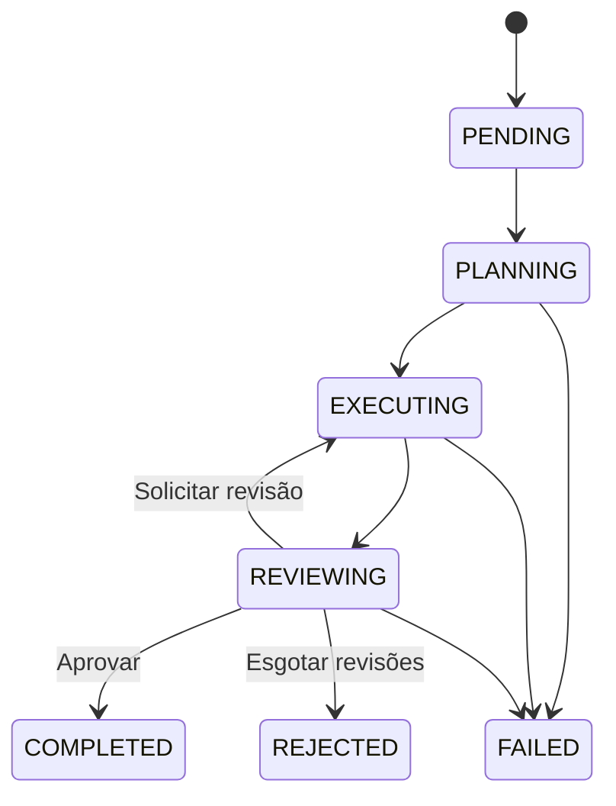

# Arquitetura e evolução

O fluxo completo por lotes está documentado em [BATCH-ANALYSIS.md](BATCH-ANALYSIS.md). A descrição abaixo registra a base do primeiro incremento e o modo sample, preservado para comparação.

## Conceito central

A engine é um monólito modular. Papéis de agentes são configurações de participantes, não processos independentes. A execução é sequencial e o plano aceita dependências em DAG. Isso permite verificar comportamento e custos antes de introduzir paralelismo.

Dependências de código: CLI → infraestrutura → aplicação → domínio. Em execução, a aplicação chama Ports que os adaptadores implementam. A inversão de dependência permite trocar a API de IA, o leitor e a memória sem alterar as entidades.

## Entidades e objetos de valor

- **Agent**: identidade estável, nome, papel, instruções, descrição, competências, ferramentas permitidas, política e habilitação. Coleções são copiadas defensivamente.
- **Task**: identidade, objetivo e estado; comportamentos controlam as transições.
- **Plan**: lista imutável de etapas; rejeita lista vazia, IDs duplicados, dependências inexistentes e ciclos; fornece ordenação topológica.
- **PlanStep**: identificador local ao plano, ferramenta e dependências.
- **ExecutionPolicy**: limites imutáveis com validação.
- **AgentRun**: registro imutável de uma operação finalizada por agente. Não representa um worker distribuído e não fornece retomada.
- **Finding**: observação produzida por regra determinística, incluindo caminho, linha, evidência e recomendação.

O estado de uma Task não fica dentro de Agent. Duas análises podem reutilizar as mesmas configurações de agentes sem compartilhar progresso. A CLI cria uma equipe por execução.

## Estados da Task

Falhas de configuração anteriores à criação da Task retornam erro da CLI. Falhas durante o caso de uso são registradas como FAILED. Uma falha ao salvar o resultado propaga erro: a aplicação não anuncia persistência que não aconteceu.

## Fluxo do caso de uso

1. Leitor coleta amostra limitada e identifica o repositório.
2. Planejador propõe JSON de etapas usando as ferramentas disponíveis.
3. Engine valida o plano, permissões, registro das ferramentas e critérios obrigatórios de análise.
4. Executor aplica ferramentas em ordem topológica; resultados ficam associados à execução.
5. Memória fornece histórico do mesmo repositório, quando habilitada.
6. Executor sintetiza evidências, amostra e objetivo.
7. Revisor compara síntese com os resultados das ferramentas e a mesma amostra de código usada pelo executor. O alvo é a precisão do relatório, inclusive quando ele identifica problemas no repositório; pode aprovar ou fornecer feedback.
8. Engine permite apenas o número configurado de novas sínteses. Ferramentas não são repetidas nas revisões.
9. Resultado aprovado pode alimentar a memória; todos os resultados finais viram JSON e Markdown.

O planejador possui autonomia de seleção e ordenação dentro de duas ferramentas autorizadas. O executor não recebe um shell. Textos de repositório e memória são delimitados como dados nos prompts. Essa delimitação reduz instruções indevidas, mas não comprova imunidade a prompt injection.

## Ports

| Port | Consumidor | Adaptador |
|---|---|---|
| RepositoryPort | AnalysisEngine | LocalRepository |
| PlanningPort | AnalysisEngine | OfflineReasoner / JsonReasoner |
| SynthesisPort | AnalysisEngine | OfflineReasoner / JsonReasoner |
| ReviewPort | AnalysisEngine | OfflineReasoner / JsonReasoner |
| ToolPort | AnalysisEngine | InventoryTool / QualityTool |
| RunRepository | AnalysisEngine | FileRunRepository |
| MemoryPort | AnalysisEngine | NoMemory / QdrantMemory |

ModelClient é um contrato interno à infraestrutura para comunicação textual com provedores; não vaza HttpClient ou JSON para a aplicação. JsonReasoner traduz o protocolo externo para Plan e ReviewDecision. QdrantMemory encapsula vetores e coleções; o domínio não conhece embeddings.

## SOLID aplicado

- **SRP**: coleta, raciocínio, orquestração, validação e persistência têm classes distintas.
- **OCP**: novos adaptadores implementam Ports; novas ferramentas exigem registro e, neste MVP, inclusão explícita em ToolId e na política de aceitação.
- **LSP**: modos local e online satisfazem contratos tipados; diferenças de qualidade semântica são informadas no resultado.
- **ISP**: planejamento, síntese e revisão são interfaces separadas, mesmo quando um adaptador implementa as três.
- **DIP**: o caso de uso depende de contratos próprios, não de Qdrant, Jackson ou uma API de IA.

## Extensões previstas

Persistência transacional de tarefas em andamento, cancelamento, retomada e versionamento de prompts são módulos futuros. Ferramentas com escrita exigirão um contrato de efeitos e política de autorização próprios. Paralelismo exige orçamento concorrente e registro de execução independente; não basta paralelizar o loop atual.
